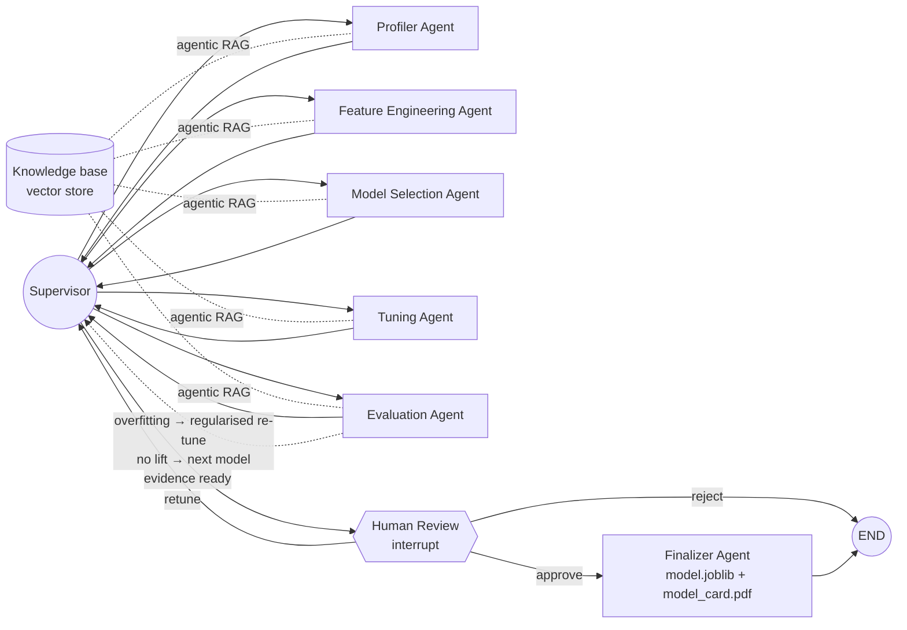

# AutoML-Agent
Built a multi-agent AI system that automates the machine learning workflow on tabular data, detecting data leakage, correcting overfitting and explaining its decisions, with a human approval step before any model is released.

# 🤖 AutoML-Agent

**An autonomous multi-agent system that builds, tunes, evaluates and explains machine learning models, and waits for human approval before anything is released.**

Upload a CSV, pick the column to predict, and a team of LangGraph agents profiles the data, catches data leakage, engineers features, compares models, tunes the best one, evaluates it on a held-out set and corrects itself if something looks wrong. It then **pauses for a human decision**. Only on approval does it export the model and a PDF model card.

---

## Why this project

Traditional AutoML tools search for a high score but behave like black boxes. They rarely explain why a column was dropped or a model was chosen, they can miss target leakage that inflates results, and they don't ask anyone before a model ships.

AutoML-Agent treats AutoML as a governed workflow instead:

- **Explainable:** every agent justifies its decisions using retrieved ML best-practice guidance (agentic RAG).
- **Trustworthy:** all numbers come from deterministic ML tools. The LLM only interprets results and is told never to invent figures.
- **Self-correcting:** overfitting or a model that fails to beat the baseline triggers automatic remediation.
- **Accountable:** no model is exported without a recorded human decision, and every agent action is logged.

## Key Features

- **Six cooperating agents** under a LangGraph supervisor: Profiler, Feature Engineering, Model Selection, Tuning, Evaluation and Finalizer
- **Automatic data audit:** detects ID-like, constant, high-cardinality, datetime and target-leakage columns, plus missing values and class imbalance
- **Fair model comparison:** leakage-safe scikit-learn pipelines, stratified 5-fold cross-validation, and a dummy baseline for reference
- **Bayesian tuning** with Optuna (TPE), including a regularised mode used for self-correction
- **Honest evaluation** on an untouched 20% hold-out set, with baseline lift, train–test gap and permutation feature importance
- **Self-correction loop** (up to two retries): regularised re-tuning on overfitting, model switching when there is no lift over the baseline
- **Agentic RAG** over a Markdown knowledge base, with query planning per agent and automatic query reformulation when retrieval is weak
- **Human-in-the-loop checkpoint** with approve / retune / reject, resumable even after a restart
- **Traceability:** SQLite run registry and audit log of every agent action and human decision
- **Auto-generated PDF model card** and a downloadable `.joblib` model bundle
- **Offline-first:** works without an API key, using template explanations with knowledge-base citations
- **Three interfaces:** Streamlit dashboard, FastAPI REST API and command line

## Architecture



Each specialist follows the same pattern: **call deterministic tools → retrieve relevant knowledge → write a grounded explanation → update the shared state → return to the Supervisor.** The Supervisor uses a rule-based routing policy (reliable and fully testable) and never performs ML itself.

### The agents

| Agent | Responsibility |
|---|---|
| **Supervisor** | Routes work, triggers self-correction, escalates to the human reviewer |
| **Profiler** | Infers the task type and flags quality and leakage risks |
| **Feature Engineering** | Builds a leakage-safe preprocessing plan and justifies each decision |
| **Model Selection** | Cross-validates Logistic/Ridge Regression, Random Forest, XGBoost and a baseline, then picks the simplest model within one standard deviation of the best |
| **Tuning** | Optuna search in standard or regularised mode, never worse than default parameters |
| **Evaluation** | Hold-out metrics, overfitting and baseline checks, feature importance |
| **Finalizer** | Exports the model bundle and PDF model card, registers the run |

### Guardrails

- The hold-out test set is never used for model selection or tuning
- Preprocessing lives inside the scikit-learn `Pipeline`, so it is fitted only on training folds
- Leakage suspects (single-feature ROC-AUC or correlation of 0.97 or higher) are dropped automatically
- Overfitting is flagged when the train–test gap exceeds 0.10, and "no lift" when the model beats the baseline by less than 0.02
- Retries are capped at two, and unresolved issues are shown to the reviewer as warnings

## Tech Stack

| Layer | Technology |
|---|---|
| Agent orchestration | LangGraph, LangChain |
| LLM reasoning | Groq-hosted LLaMA 3.3 70B (optional) |
| Machine learning | scikit-learn, XGBoost, Optuna, pandas, NumPy |
| Retrieval (RAG) | TF-IDF vector store by default, optional MiniLM embeddings |
| State and memory | LangGraph SQLite checkpointer, SQLite run registry and audit log |
| Interfaces | Streamlit, FastAPI, command line |
| Reports | ReportLab, Matplotlib |
| Testing | Pytest |

## Results

Evaluated on five datasets with a fixed 80/20 stratified split (seed 42), 25 Optuna trials and the LLM disabled so results are reproducible. Every approved model clearly beat its dummy baseline.

| Dataset | Task | Selected model | Metric | Tuned CV | Hold-out test | Baseline | Train–test gap |
|---|---|---|---|---|---|---|---|
| Customer churn (synthetic) | Binary | Logistic Regression | ROC-AUC | 0.802 | **0.760** | 0.500 | 0.046 |
| Breast Cancer Wisconsin | Binary | Logistic Regression | ROC-AUC | 0.996 | **0.994** | 0.500 | 0.003 |
| Wine | Multiclass | Logistic Regression | Macro-F1 | 0.980 | **0.971** | 0.187 | 0.029 |
| Diabetes | Regression | Ridge | R² | 0.481 | **0.454** | −0.012 | 0.074 |
| Noisy small (synthetic) | Binary | Random Forest | ROC-AUC | 0.790 | **0.693** | 0.500 | 0.304 |

The last dataset is deliberately noisy (2 informative features among 25) to stress-test self-correction. The system reduced the overfitting where it could and flagged the remaining risk to the reviewer instead of hiding it.

On the churn dataset, the Profiler automatically removed three planted problems: an ID column (`customer_id`), a constant column (`region_code`) and a leaking column (`account_closed`). Without leakage detection, the leaked column would have produced an inflated 0.987 ROC-AUC.

## Getting Started

### Prerequisites

- Python 3.11 or 3.12
- (Optional) a free [Groq API key](https://console.groq.com/keys) for LLM-written explanations

### Installation

```bash
git clone https://github.com/PrathishaRamMohan/automl-agent.git
cd automl-agent

python -m venv .venv
# Windows:      .venv\Scripts\activate
# macOS/Linux:  source .venv/bin/activate

pip install -r requirements.txt
```

### Configuration (optional)

```bash
cp .env.example .env      # Windows: copy .env.example .env
```

Add your key to `GROQ_API_KEY` in `.env`. Without a key, every agent still runs and falls back to template explanations with knowledge-base citations.

| Variable | Default | Purpose |
|---|---|---|
| `GROQ_API_KEY` | empty | Enables LLM reasoning |
| `GROQ_MODEL` | `llama-3.3-70b-versatile` | Model hosted on Groq |
| `USE_LLM` | `true` | Set to `false` to run fully offline |
| `EMBEDDINGS` | `tfidf` | Use `minilm` for dense embeddings (needs `sentence-transformers`) |
| `N_TRIALS` | `25` | Default Optuna trials |

## Usage

### Streamlit dashboard

```bash
streamlit run app/streamlit_app.py
```

Open http://localhost:8501, choose the sample churn dataset or upload your own CSV, select the target column and click **Run agents**. When the run pauses, review the leaderboard, tuning curve, feature importance and agent reasoning, then approve, retune or reject. After approval you can download the PDF model card and model bundle, and score new data.

### Command line

```bash
python -m automl_agent.cli --data data/sample_churn.csv --target churn
```

### REST API

```bash
uvicorn api.main:app --reload
```

Interactive docs are at http://localhost:8000/docs.

| Method and path | Description |
|---|---|
| `GET /health` | Service status and whether the LLM is enabled |
| `POST /runs` | Upload a CSV and target, run all agents until human review |
| `GET /runs` | List all runs |
| `GET /runs/{id}` | Full run summary: status, leaderboard, evaluation, trace |
| `GET /runs/{id}/audit` | Audit log for a run |
| `POST /runs/{id}/decision` | Resume a paused run with approve, reject or retune |
| `GET /runs/{id}/report` | Download the PDF model card (approved runs only) |
| `POST /runs/{id}/predict` | Score JSON rows with an approved model |

Example:

```bash
curl -F "file=@data/sample_churn.csv" -F "target=churn" -F "n_trials=15" localhost:8000/runs
curl -X POST localhost:8000/runs/<run_id>/decision \
     -H "Content-Type: application/json" \
     -d '{"decision":"approve","reviewer":"Your Name"}'
curl -o card.pdf localhost:8000/runs/<run_id>/report
```

### Using your own data

Any CSV with a target column works. The task type (binary, multiclass or regression) is detected automatically. Extend the RAG knowledge base by adding Markdown files to `knowledge_base/`.

### Tests

```bash
pytest -v
```

Tests run offline with the LLM disabled and cover the ML tools, the Supervisor's routing and self-correction policy, full graph runs through the human checkpoint, and the REST API.

## Project Structure

```
automl-agent/
├── automl_agent/
│   ├── agents/          # supervisor, profiler, feature_engineer, model_selector,
│   │                    # tuner, evaluator, human_review, finalizer
│   ├── tools/           # profiling, features, modeling, tuning, evaluation (pure ML)
│   ├── graph.py         # LangGraph wiring, run and resume helpers
│   ├── state.py         # shared agent state
│   ├── rag.py           # vector store and agentic retrieval
│   ├── llm.py           # Groq LLM wrapper with offline fallback
│   ├── db.py            # SQLite run registry and audit log
│   ├── report.py        # PDF model card
│   ├── cli.py           # command-line interface
│   └── config.py
├── app/                 # Streamlit dashboard (streamlit_app.py, ui.py)
├── api/main.py          # FastAPI backend
├── knowledge_base/      # ML best-practice documents used by RAG
├── data/sample_churn.csv
├── scripts/make_sample_data.py
├── tests/
└── runs/                # created at runtime: models, reports, SQLite databases
```

## Limitations

- Supports tabular supervised learning only (no time series, text or image data)
- The statistical leakage test can produce false positives on genuinely strong features
- Rule-based routing is reliable but less flexible than LLM-planned routing
- The train–test gap is a noisy overfitting signal on very small datasets
- No probability calibration, threshold tuning or fairness analysis yet
- It recommends and documents a model but does not deploy it automatically

## Future Work

- Let reviewers confirm leakage suspects instead of dropping them automatically
- Cross-validated overfitting estimates and repeated splits for small datasets
- A Drift Monitor Agent that scores new batches and triggers retraining through the same approval workflow
- LLM-planned routing with structured outputs, keeping the rule-based policy as a safety fallback
- Additional agents for threshold tuning, probability calibration, SHAP explanations and fairness checks

## Author

**Prathisha R**, B.Tech Artificial Intelligence and Machine Learning, Rajalakshmi Engineering College, Chennai

Built as the mini-project for *AD23731 Foundations of Agentic AI*.

